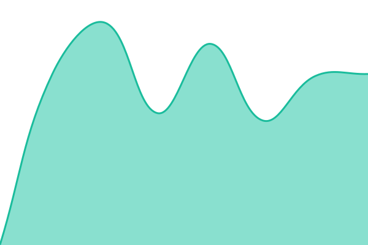

# [📈 Nelson College London — Live Service Status](https://status.nelsoncollege.ac.uk): <!--live status--> **Partial Outage**

<!--start: status pages-->
<!-- This summary is generated by Upptime (https://github.com/upptime/upptime) -->
<!-- Do not edit this manually, your changes will be overwritten -->
<!-- prettier-ignore -->
| URL | Status | History | Response Time | Uptime |
| --- | ------ | ------- | ------------- | ------ |
|  [Website](https://nelsoncollege.ac.uk) | 🟩 Up | [website.yml](https://github.com/travnettech/ncl_status/commits/HEAD/history/website.yml) | 

 1116ms
     
 | 

<a href="https://travnettech.github.io/ncl_status/history/website">100.00%</a>
    

|  [Virtual Learning Environment VLE](https://nclvle.co.uk) | 🟩 Up | [virtual-learning-environment-vle.yml](https://github.com/travnettech/ncl_status/commits/HEAD/history/virtual-learning-environment-vle.yml) | 

 618ms
     
 | 

<a href="https://travnettech.github.io/ncl_status/history/virtual-learning-environment-vle">100.00%</a>
    

|  [Nelson One](https://one.nelsoncollege.ac.uk) | 🟥 Down | [nelson-one.yml](https://github.com/travnettech/ncl_status/commits/HEAD/history/nelson-one.yml) | 

 1258ms
     
 | 

<a href="https://travnettech.github.io/ncl_status/history/nelson-one">0.00%</a>
    

|  [Nelson Portal](https://portal.nelsoncollege.ac.uk) | 🟩 Up | [nelson-portal.yml](https://github.com/travnettech/ncl_status/commits/HEAD/history/nelson-portal.yml) | 

 1252ms
     
 | 

<a href="https://travnettech.github.io/ncl_status/history/nelson-portal">100.00%</a>
    

|  [NCL Alumni Association](https://alumni.nelsoncollege.ac.uk) | 🟩 Up | [ncl-alumni-association.yml](https://github.com/travnettech/ncl_status/commits/HEAD/history/ncl-alumni-association.yml) | 

 655ms
     
 | 

<a href="https://travnettech.github.io/ncl_status/history/ncl-alumni-association">100.00%</a>
    

|  [Help Centre](https://nelsoncollege.atlassian.net/servicedesk/customer/portals) | 🟩 Up | [help-centre.yml](https://github.com/travnettech/ncl_status/commits/HEAD/history/help-centre.yml) | 

 1973ms
     
 | 

<a href="https://travnettech.github.io/ncl_status/history/help-centre">100.00%</a>
    

|  [Status Page](https://status.nelsoncollege.ac.uk) | 🟩 Up | [status-page.yml](https://github.com/travnettech/ncl_status/commits/HEAD/history/status-page.yml) | 

 374ms
     
 | 

<a href="https://travnettech.github.io/ncl_status/history/status-page">100.00%</a>
    

<!--end: status pages-->

[**View the NCL Status Page →**](https://status.nelsoncollege.ac.uk)
